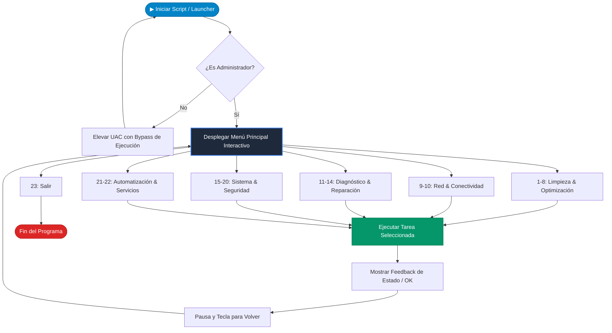

<div align="center">

# ⚡ WIN-OPTIMIZADOR PRO

### *Suite Integral de Mantenimiento, Optimización y Diagnóstico para Windows*

[](https://learn.microsoft.com/powershell/)
[](https://microsoft.com/windows)
[](https://github.com/Luis3223/proyecto-mantenimiento-de-os)
[](LICENSE)
[]()

<br/>

```text
======================================================================
             WIN-OPTIMIZADOR PRO - 22 FUNCIONES               
======================================================================
 [1-8]  Limpieza y Optimización     [9-10] Red y Conectividad
 [11-14] Diagnóstico y Reparación   [15-20] Sistema y Seguridad
 [21-22] Automatización de Red y Servicios
======================================================================
```

<p align="center">
  <b>Una solución automatizada en PowerShell diseñada para maximizar el rendimiento, sanar archivos del sistema y simplificar el mantenimiento preventivo y correctivo en Windows.</b>
</p>

[🚀 Inicio Rápido](#-inicio-rápido) • [📋 Catálogo de Funciones](#-catálogo-de-22-funciones) • [📐 Diagrama de Flujo](#-diagrama-de-arquitectura) • [📁 Estructura del Repositorio](#-estructura-del-repositorio) • [🛡️ Seguridad](#-seguridad-y-buenas-prácticas)

</div>

---

## 🌟 Características Destacadas

- ⚡ **Auto-Elevación de Privilegios**: Detecta si corre sin permisos de administrador y se relanza solicitando confirmación UAC de manera automática.
- 🧹 **Limpieza Profunda**: Purga archivos temporales, Prefetch, historial de portapapeles, logs obsoletos y caché de Windows Update.
- 🩺 **Salud del Sistema (DISM + SFC + CHKDSK)**: Diagnóstico y reparación integral de la imagen del sistema operativo e integridad de sectores de disco.
- 📶 **Reparación de Red (TCP/IP & Winsock)**: Renovación DNS/IP completa y reseteo del catálogo de sockets de red.
- 🗂️ **Organización Inteligente de Archivos**: Clasificación automática por extensiones de archivos sueltos en el Escritorio y en Descargas.
- 🛡️ **Puntos de Restauración Integrados**: Crea puntos de control del sistema previos a cualquier mantenimiento crítico.
- 🚀 **Modo "Mantenimiento Total"**: Opción automatizada en un solo clic que encadena limpieza temporal, vaciado de papelera y reseteo de red.

---

## 📐 Diagrama de Arquitectura



---

## 🚀 Inicio Rápido

### Método 1: Lanzador de 1 Clic (Recomendado) 🖱️
1. Descarga o clona el repositorio.
2. Haz doble clic sobre **`Iniciar-WinOptimizador.bat`**.
3. Acepta los permisos de Administrador en el diálogo de Windows (UAC) ¡y listo!

### Método 2: Desde Consola PowerShell 💻
Abre PowerShell como Administrador en la carpeta del proyecto y ejecuta:

```powershell
Set-ExecutionPolicy -Scope Process -ExecutionPolicy Bypass
.\winoptimizador.ps1
```

---

## 📋 Catálogo de 22 Funciones

| # | Módulo | Categoría | Descripción Técnica |
|---|---|---|---|
| **01** | `Limpiar Temporales y Prefetch` | 🧹 Limpieza | Purga recursiva de directorios `$env:TEMP`, `C:\Windows\Temp` y `C:\Windows\Prefetch`. |
| **02** | `Vaciar Papelera de Reciclaje` | 🧹 Limpieza | Ejecución de `Clear-RecycleBin -Force` de todas las unidades montadas. |
| **03** | `Limpiar Caché Windows Update` | 🧹 Limpieza | Detiene temporalmente `wuauserv`, limpia `SoftwareDistribution\Download` y reanuda el servicio. |
| **04** | `Eliminar Archivos de Log` | 🧹 Limpieza | Búsqueda y eliminación de archivos `*.log` obsoletos acumulados en el directorio del sistema. |
| **05** | `Limpiar Portapapeles` | 🧹 Limpieza | Vaciado de memoria del portapapeles de Windows (`Set-Clipboard -Value $null`). |
| **06** | `Optimizar y Desfragmentar Discos` | ⚡ Rendimiento | Ejecución de `Optimize-Volume` con ReTrim sobre la unidad `C:`. |
| **07** | `Organizar Escritorio` | 🗂️ Organización | Mueve y categoriza automáticamente archivos en subcarpetas según su extensión. |
| **08** | `Organizar Descargas` | 🗂️ Organización | Escanea la carpeta `Downloads` del usuario y agrupa los archivos por formato/tipo. |
| **09** | `Limpiar DNS y Renovar IP` | 🌐 Red | Ejecuta secuencia `ipconfig /flushdns`, `/release` y `/renew`. |
| **10** | `Restablecer Adaptadores (Winsock)` | 🌐 Red | Ejecuta `netsh winsock reset` para resolver corrupción de la pila de red. |
| **11** | `Escanear Sistema (SFC)` | 🩺 Diagnóstico | Ejecuta `sfc /scannow` para auditar e integrar archivos protegidos de Windows. |
| **12** | `Reparar Imagen (DISM)` | 🩺 Diagnóstico | `DISM /Online /Cleanup-Image /RestoreHealth` para reparar componentes desde Windows Update. |
| **13** | `Comprobar Errores de Disco` | 🩺 Diagnóstico | Ejecuta `chkdsk C:` en modo lectura para auditar sectores y metadatos NTFS. |
| **14** | `Restablecer Microsoft Store` | 🩺 Diagnóstico | Ejecuta `wsreset.exe` para limpiar la memoria caché de la tienda oficial. |
| **15** | `Crear Punto de Restauración` | 🛡️ Seguridad | Habilita `SystemRestore` en `C:\` y genera un snapshot `Checkpoint-Computer`. |
| **16** | `Monitor de Consumo RAM y CPU` | 📊 Monitoreo | Muestra el Top 5 de procesos que más memoria física consumen en tiempo real. |
| **17** | `Exportar Información del Sistema` | 📊 Diagnóstico | Genera reporte completo de hardware y controladores `dxdiag /t` en el Escritorio. |
| **18** | `Gestionar Hibernación` | ⚙️ Configuración | Permite habilitar o deshabilitar `powercfg.exe /hibernate` liberando espacio de `hiberfil.sys`. |
| **19** | `Deshabilitar Telemetría Básica` | 🔒 Privacidad | Detiene y deshabilita el servicio de rastreo y telemetría `DiagTrack`. |
| **20** | `Mantenimiento Total Automático` | 🚀 Express | Secuencia completa sin intervención: temporales, papelera y flush DNS. |
| **21** | `Configurar Red a DHCP (Fase 1)` | 📶 Automatización | Configura la interfaz a asignación dinámica de IP y DNS vía `netsh interface ip`. |
| **22** | `Optimizar Spooler de Impresión` | ⚙️ Servicios | Diagnostica, detiene y deshabilita el servicio de cola de impresión si no es necesario. |

---

## 📁 Estructura del Repositorio

```text
proyecto-mantenimiento-de-os/
│
├── 📄 Iniciar-WinOptimizador.bat   # Lanzador directo con elevación UAC en 1 clic
├── 📜 winoptimizador.ps1          # Núcleo del script con las 22 herramientas en PowerShell
│
├── 📂 docs/
│   └── 📘 ARQUITECTURA.md         # Documentación técnica extendida y justificación de módulos
│
├── 📄 .gitignore                  # Filtro de logs, volcados DXDIAG y temporales
├── 📄 LICENSE                     # Licencia de código abierto MIT
└── 📄 README.md                    # Panel de control y documentación principal
```

---

## 🛡️ Seguridad y Buenas Prácticas

> [!IMPORTANT]
> **Privilegios de Administrador**: Gran parte de las herramientas (como DISM, SFC, manipulación de servicios y optimización de volumen) requieren acceso de nivel Administrador para interactuar con las APIs del Kernel de Windows.

> [!TIP]
> **Antes de mantenimientos mayores**: Se recomienda utilizar la **Opción 15 (Crear Punto de Restauración)** antes de realizar tareas como deshabilitar telemetría o modificar la configuración de red.

---

## 👨‍💻 Autor y Créditos

Proyecto desarrollado para el módulo de **Mantenimiento de Sistemas Operativos**.
- **Autor**: [Luis Angel](https://github.com/Luis3223)
- **Repositorio**: [proyecto-mantenimiento-de-os](https://github.com/Luis3223/proyecto-mantenimiento-de-os)

---

<div align="center">
  <sub>Construido con ❤️ y PowerShell para mantener tu sistema ágil, limpio y seguro.</sub>
</div>
