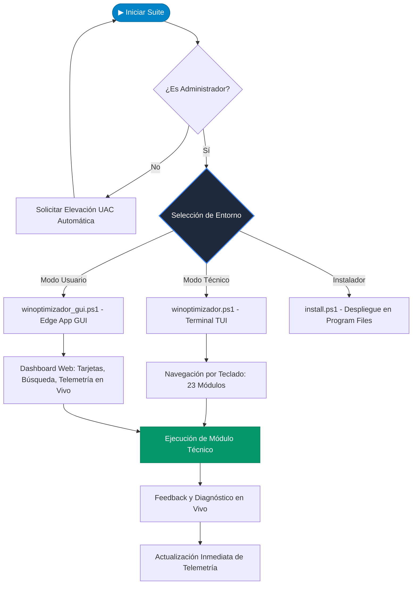

<div align="center">

# ⚡ WIN-OPTIMIZADOR PRO v2.0

### *Suite Integral de Mantenimiento, Optimización y Diagnóstico para Windows*

[](https://learn.microsoft.com/powershell/)
[](https://microsoft.com/windows)
[](https://github.com/Luis3223/proyecto-mantenimiento-de-os)
[](LICENSE)
[-brightgreen?style=for-the-badge)]()

<br/>

```text
======================================================================
             WIN-OPTIMIZADOR PRO - 23 FUNCIONES INTEGRADAS
======================================================================
 [1-8, 23] Limpieza, Espacio y Archivos Pesados
 [9-10, 21] Red, Conectividad y Estandarización DHCP
 [11-14]    Salud del Sistema, SFC, DISM y CHKDSK
 [15-20]    Seguridad, Telemetría, Privacidad y Modo 1-Clic
 [22]       Optimización de Servicios de Segundo Plano
======================================================================
```

<p align="center">
  <b>Una solución profesional de grado empresarial diseñada para acelerar Windows, recuperar gigabytes de espacio, reparar archivos del sistema y simplificar el mantenimiento preventivo y correctivo.</b>
</p>

[🚀 Métodos de Instalación](#-cómo-instalar-y-usar-para-todos-los-públicos) • [📋 Catálogo de Funciones](#-catálogo-de-23-funciones) • [🛠️ Arquitectura](#-diagrama-de-arquitectura) • [📁 Estructura del Repositorio](#-estructura-del-repositorio) • [📘 Guía de Instalación Detallada](docs/GUIA_INSTALACION.md)

</div>

---

## 🌟 ¿Qué es Win-Optimizador Pro?

**Win-Optimizador Pro** es una suite de mantenimiento diseñada desde cero para cubrir las necesidades de **dos tipos de usuarios**:

1. **🛠️ Para Técnicos y Administradores de TI (Modo TUI Consola):**
   - Una terminal interactiva ultrarrápida con controles por teclado (`↑`, `↓`, `←`, `→`, `Tab`).
   - Monitor de telemetría en vivo (CPU, RAM y espacio libre en `C:`).
   - Acceso instantáneo por comando remoto en una sola línea de PowerShell, ideal para sesiones de **AnyDesk, TeamViewer o SSH**.
2. **🖱️ Para Usuarios Comunes (Modo Gráfico Asistido Fluent):**
   - Interfaz visual moderna, elegante y amigable basada en diseño por tarjetas.
   - Modo **Mantenimiento Total en 1-Clic**: limpia temporales, vacía la papelera y renueva la red automáticamente.
   - Se ejecuta en una ventana nativa independiente de Microsoft Edge (`--app`), sin consumir recursos ni requerir instalación de navegadores externos ni Electron.

---

## 🚀 Cómo Instalar y Usar (Para Todos los Públicos)

Diseñado para que **cualquier persona** (con o sin experiencia técnica) pueda ponerlo en marcha en segundos.

### ⚡ Método A: Para Técnicos (1 Sola Línea en PowerShell — Sin Descargar Nada)
Si estás en una sesión de soporte remoto o necesitas diagnosticar un equipo rápidamente:
1. Abre **PowerShell como Administrador** (`Win + X` ➔ *Terminal / PowerShell como Administrador*).
2. Pega este comando y presiona `Enter`:

```powershell
irm https://raw.githubusercontent.com/Luis3223/proyecto-mantenimiento-de-os/main/run.ps1 | iex
```

> [!TIP]
> Puedes pasarle parámetros directos:
> - `& { irm ... | iex } -Modo TUI` (Abre directamente la terminal interactiva).
> - `& { irm ... | iex } -Modo GUI` (Abre directamente la ventana gráfica).
> - `& { irm ... | iex } -Modo Install` (Instala la suite permanentemente en el equipo en 5 segundos).

---

### 📦 Método B: Instalador en 1-Clic (Para Usuarios que desean la aplicación instalada)
1. [Descarga el ZIP del proyecto](https://github.com/Luis3223/proyecto-mantenimiento-de-os/archive/refs/heads/main.zip) y descomprímelo.
2. Haz doble clic en **`Instalar-WinOptimizador.bat`**.
3. ¡Listo! Se instalará en `C:\Program Files\WinOptimizador` y creará accesos automáticos en tu **Menú Inicio**, en tu **Escritorio** y registrará los comandos globales `winoptimizador` y `winoptimizador-gui` en tu terminal.

---

### 💼 Método C: Modo Portable (Para Memoria USB de Soporte)
Si trabajas como técnico en terreno y llevas una memoria USB:
1. Copia la carpeta del proyecto en tu pendrive.
2. Conéctalo en cualquier equipo y haz doble clic en:
   - **`WinOptimizador-Grafico.bat`**: Si deseas la interfaz visual.
   - **`WinOptimizador-Tecnico.bat`**: Si prefieres la consola interactiva por teclado.
   - **`Iniciar-WinOptimizador.bat`**: Para ver el menú selector maestro.
   - *(Cero huellas en el sistema del cliente).*

> 👉 Para más detalles paso a paso, consulta la [📘 Guía Completa de Instalación y Despliegue](docs/GUIA_INSTALACION.md).

---

## 📋 Catálogo de 23 Funciones

| # | Módulo | Categoría | Descripción Técnica |
|---|---|---|---|
| **01** | `Limpiar Temporales y Prefetch` | 🧹 Limpieza | Purga recursiva de directorios `$env:TEMP`, `C:\Windows\Temp` y `C:\Windows\Prefetch`. |
| **02** | `Vaciar Papelera de Reciclaje` | 🧹 Limpieza | Ejecución de `Clear-RecycleBin -Force` en todas las unidades montadas. |
| **03** | `Limpiar Caché Windows Update` | 🧹 Limpieza | Detiene temporalmente `wuauserv`, limpia `SoftwareDistribution\Download` y reanuda el servicio. |
| **04** | `Eliminar Archivos de Log` | 🧹 Limpieza | Búsqueda y eliminación de archivos `*.log` obsoletos acumulados en el sistema. |
| **05** | `Limpiar Portapapeles` | 🧹 Limpieza | Vaciado de memoria del portapapeles de Windows (`Set-Clipboard -Value $null`). |
| **06** | `Optimizar y Desfragmentar Discos` | ⚡ Rendimiento | Ejecución de `Optimize-Volume` con ReTrim sobre la unidad `C:`. |
| **07** | `Organizar Escritorio` | 🗂️ Organización | Mueve y categoriza automáticamente archivos en subcarpetas según su formato/extensión. |
| **08** | `Organizar Descargas` | 🗂️ Organización | Escanea la carpeta `Downloads` del usuario y agrupa los archivos por formato/tipo. |
| **09** | `Limpiar DNS y Renovar IP` | 🌐 Red | Ejecuta secuencia `ipconfig /flushdns`, `/release` y `/renew`. |
| **10** | `Restablecer Adaptadores (Winsock)` | 🌐 Red | Ejecuta `netsh winsock reset` para resolver corrupción en la pila de red. |
| **11** | `Escanear Sistema (SFC)` | 🩺 Diagnóstico | Ejecuta `sfc /scannow` para auditar e integrar archivos protegidos de Windows. |
| **12** | `Reparar Imagen (DISM)` | 🩺 Diagnóstico | `DISM /Online /Cleanup-Image /RestoreHealth` para reparar el almacén de componentes. |
| **13** | `Comprobar Errores de Disco` | 🩺 Diagnóstico | Ejecuta `chkdsk C:` en modo lectura para auditar sectores y metadatos NTFS. |
| **14** | `Restablecer Microsoft Store` | 🩺 Diagnóstico | Ejecuta `wsreset.exe` para limpiar la memoria caché de la tienda oficial. |
| **15** | `Crear Punto de Restauración` | 🛡️ Seguridad | Habilita `SystemRestore` en `C:\` y genera un snapshot `Checkpoint-Computer`. |
| **16** | `Monitor de Consumo RAM y CPU` | 📊 Monitoreo | Muestra el Top 5 de procesos que más memoria física y CPU consumen en vivo. |
| **17** | `Exportar Información del Sistema` | 📊 Diagnóstico | Genera reporte completo de hardware y controladores `dxdiag /t` en el Escritorio. |
| **18** | `Gestionar Hibernación` | ⚙️ Configuración | Permite habilitar o deshabilitar `powercfg.exe /hibernate` liberando gigabytes de `hiberfil.sys`. |
| **19** | `Deshabilitar Telemetría Básica` | 🔒 Privacidad | Detiene y deshabilita el servicio de rastreo y telemetría `DiagTrack`. |
| **20** | `Mantenimiento Total Automático` | 🚀 Express | Secuencia completa sin intervención: temporales, papelera y flush DNS. |
| **21** | `Configurar Red a DHCP (Fase 1)` | 📶 Automatización | Configura la interfaz a asignación dinámica de IP y DNS vía `netsh interface ip`. |
| **22** | `Optimizar Spooler de Impresión` | ⚙️ Servicios | Diagnostica, detiene y deshabilita el servicio de cola de impresión si no es necesario. |
| **23** | `Analizar y Liberar Archivos Pesados`| 🧹 Limpieza | Escanea archivos que más espacio ocupan (>10MB), permite selección interactiva y reporta con exactitud los MB/GB liberados. |

---

## 📐 Diagrama de Arquitectura



---

## 📁 Estructura del Repositorio

```text
proyecto-mantenimiento-de-os/
│
├── 📦 Instalar-WinOptimizador.bat     # Instalador en 1-Clic (Crea accesos en Menú Inicio, Escritorio y PATH)
├── 🗑️ Desinstalar-WinOptimizador.bat  # Desinstalador limpio para retirar la suite del sistema
├── 🖱️ WinOptimizador-Grafico.bat     # Lanzador portátil directo para usuarios (Abre la GUI moderna)
├── 🛠️ WinOptimizador-Tecnico.bat     # Lanzador portátil directo para técnicos (Abre la TUI interactiva)
├── 🚀 Iniciar-WinOptimizador.bat     # Lanzador maestro con menú selector de modo
├── 📌 Crear-Acceso-Directo.bat      # Genera un acceso directo portátil en el Escritorio
├── 🌐 run.ps1                        # Bootstrapper remoto para ejecutar o instalar en 1 sola línea
├── ⚙️ install.ps1                    # Lógica de instalación en C:\Program Files y registro de accesos
│
├── 🖥️ winoptimizador_gui.ps1        # Servidor backend HTTP local y lanzador Edge App Mode
├── 📜 winoptimizador.ps1            # Suite interactiva TUI para consola con teclado y telemetría
│
├── 📂 gui/                           # Interfaz gráfica moderna (HTML5, CSS3 Glassmorphism, JS)
│   ├── index.html                    # Maquetación semántica, dashboard y modales de diálogo
│   ├── style.css                     # Sistema de diseño Fluent dark-mode, animaciones y scroll
│   └── app.js                        # Lógica frontend, telemetría en tiempo real y escáner
│
├── 📂 docs/
│   ├── 📖 GUIA_INSTALACION.md       # Manual de despliegue para usuarios, técnicos y USB
│   └── 📘 ARQUITECTURA.md           # Justificación técnica y documentación modular profunda
│
├── 📂 .github/ISSUE_TEMPLATE/        # Plantillas oficiales de incidencias y propuestas
├── 📄 CHANGELOG.md                   # Historial de versiones y cambios del proyecto
├── 📄 CONTRIBUTING.md                # Guía de contribución para desarrolladores
├── 📄 .gitignore                    # Filtro de archivos temporales y caché
├── 📄 LICENSE                       # Licencia de código abierto MIT
└── 📄 README.md                      # Documentación principal de la suite
```

---

## 🛡️ Seguridad y Buenas Prácticas

> [!IMPORTANT]
> **Privilegios de Administrador**: Gran parte de las herramientas (como DISM, SFC, manipulación de servicios y optimización de volumen) requieren acceso de nivel Administrador para interactuar con las APIs del Kernel de Windows.

> [!TIP]
> **Antes de mantenimientos mayores**: Se recomienda utilizar la **Opción 15 (Crear Punto de Restauración)** antes de realizar tareas críticas como deshabilitar telemetría o modificar la configuración de red.

---

## 👨‍💻 Autor y Créditos

Proyecto desarrollado para la asignatura de **Mantenimiento de Sistemas Operativos**.
- **Autor**: [Luis Angel](https://github.com/Luis3223)
- **Repositorio**: [proyecto-mantenimiento-de-os](https://github.com/Luis3223/proyecto-mantenimiento-de-os)

---

<div align="center">
  <sub>Construido con ❤️ y PowerShell para mantener tu Windows ágil, limpio y seguro.</sub>
</div>
